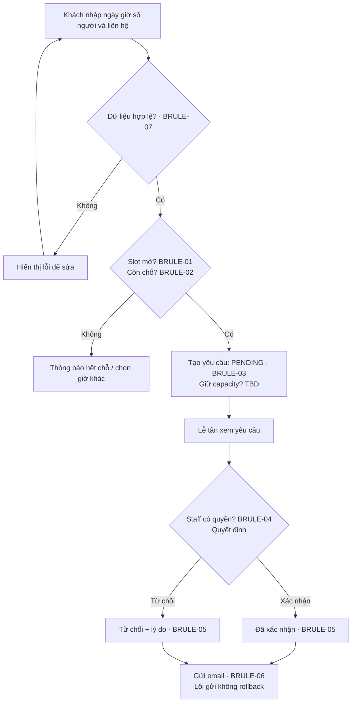

# 04 — Process & Data Model

## To-Be flow (Mermaid)

Lưu ý: các rule đều là Draft/TBD; riêng việc giữ capacity khi PENDING chưa được quyết định. Sơ đồ draw.io có nhãn rule: [10-Reservation-To-Be.drawio](./10-Reservation-To-Be.drawio).

Chi tiết và decision table thực hành: [Business Rules và Decision Tables](./26-Business-Rules-va-Decision-Tables.md).

## Quy tắc nghiệp vụ (draft, cần xác nhận)
- BRULE-01: Không nhận đặt ngoài giờ mở cửa.
- BRULE-02: Không cho vượt giới hạn sức chứa tại cùng một khung giờ.
- BRULE-03: Yêu cầu mới mặc định ở trạng thái “Chờ xác nhận”.
- BRULE-04: Chỉ nhân viên được phép xác nhận/từ chối.
- BRULE-05: Mọi thay đổi trạng thái phải lưu người thực hiện và thời điểm.

## Data entities
- Reservation(id, reservation_code, customer_name, phone, email, party_size, start_at, status, note, created_at)
- ReservationStatusHistory(id, reservation_id, old_status, new_status, changed_by, changed_at, reason)
- AvailabilitySlot(id, start_at, capacity, reserved_capacity, is_open)
- StaffUser(id, name, role, active)

## Data questions
- Sức chứa gắn với số khách, số bàn hay tổ hợp bàn?
- Có lưu lịch sử hủy và lý do trong bao lâu?
- Email hay số điện thoại bắt buộc? Chính sách dữ liệu áp dụng thế nào?

