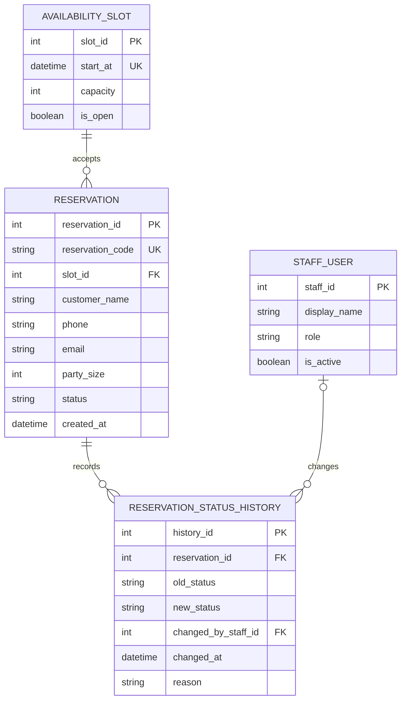

# 12 — Data modeling, SQL và Postman cho BA

## Mục tiêu
Đọc yêu cầu theo góc nhìn dữ liệu và API: dữ liệu nào được thu, liên kết ra sao, quy tắc nào phải kiểm tra, lỗi nào người dùng cần hiểu. Schema và API dưới đây phục vụ luyện tập, không phải thiết kế đã được phê duyệt.

## 1. Mô hình dữ liệu



Một Reservation thuộc một slot, còn một slot có thể có nhiều reservation. Lịch sử tách riêng để giữ được mọi chuyển trạng thái, thay vì ghi đè trạng thái cũ. `changed_by_staff_id` để trống cho sự kiện do hệ thống tạo; trong mô hình thật cần phân biệt rõ actor hệ thống và nhân viên.

Mở [Reservation-Practice.sql](./Reservation-Practice.sql) để xem schema SQLite, khóa, ràng buộc, index, view tính sức chứa và dữ liệu hoàn toàn giả lập. Quy tắc mẫu đang tính cả PENDING và CONFIRMED vào số chỗ đã dùng; cần xác nhận với stakeholder. Với cơ sở dữ liệu thực, cần xử lý cập nhật sức chứa nguyên tử khi có nhiều yêu cầu đồng thời.

## 2. Truy vấn SQL để BA kiểm tra dữ liệu

**Sức chứa còn lại theo slot**
```sql
SELECT start_at, capacity, seats_occupied, seats_remaining
FROM slot_utilization
ORDER BY start_at;
```

**Tìm đặt bàn đang chờ của một ngày**
```sql
SELECT r.reservation_code, r.customer_name, r.party_size,
       s.start_at, r.status
FROM reservation r
JOIN availability_slot s ON s.slot_id = r.slot_id
WHERE s.start_at >= '2026-12-05T00:00:00+07:00'
  AND s.start_at <  '2026-12-06T00:00:00+07:00'
  AND r.status = 'PENDING'
ORDER BY s.start_at;
```

**Kiểm tra lịch sử trạng thái**
```sql
SELECT r.reservation_code, h.old_status, h.new_status,
       h.changed_at, u.display_name, h.reason
FROM reservation_status_history h
JOIN reservation r ON r.reservation_id = h.reservation_id
LEFT JOIN staff_user u ON u.staff_id = h.changed_by_staff_id
ORDER BY r.reservation_code, h.changed_at;
```

Đối chiếu kết quả với AC và quy tắc nghiệp vụ; đếm hàng có thể kiểm tra dữ liệu, nhưng không chứng minh một quy trình nghiệp vụ đúng.

### So sánh khi `PENDING` có/không giữ chỗ

View `slot_utilization` hiện tính `PENDING` và `CONFIRMED` là đã dùng chỗ. Nếu business owner quyết định chỉ `CONFIRMED` mới giữ chỗ, query phân tích cần đổi điều kiện trạng thái:

```sql
SELECT
    s.start_at,
    s.capacity,
    COALESCE(SUM(CASE WHEN r.status = 'CONFIRMED'
                      THEN r.party_size ELSE 0 END), 0) AS seats_held,
    s.capacity - COALESCE(SUM(CASE WHEN r.status = 'CONFIRMED'
                                   THEN r.party_size ELSE 0 END), 0) AS seats_available_by_policy
FROM availability_slot s
LEFT JOIN reservation r ON r.slot_id = s.slot_id
GROUP BY s.slot_id, s.start_at, s.capacity
ORDER BY s.start_at;
```

Điều kiện SQL chỉ phản ánh policy **nếu policy đã được duyệt**. Đổi query không làm hệ thống tự an toàn hơn: nếu `PENDING` thật sự không giữ chỗ, nhiều khách vẫn có thể cùng nhìn thấy capacity rồi cùng gửi request. Cần xác định thời điểm giữ chỗ, transaction/kiểm tra đồng thời và cách xử lý yêu cầu cạnh tranh; đây là phần cần phối hợp Product/Operations/Engineering/QA.

Trước khi dùng kết quả báo “còn chỗ”, xác minh ít nhất: capacity tính theo ghế hay bàn/tổ hợp bàn; request từ điện thoại/đi bộ có cùng nguồn dữ liệu không; cancellation/hold expiry được phản ánh ra sao; slot và timezone dùng chuẩn nào; dữ liệu là snapshot thời điểm nào; truy vấn có thể quan sát cùng lúc request đang được tạo hay không. Thiếu một nguồn ngoài hệ thống có thể làm query đúng trên database nhưng sai với tình hình vận hành.

## 3. API contract và Postman

Collection [Postman-Collection.json](./Postman-Collection.json) có hai request minh họa cho API giả định `POST /api/reservations`: tạo thành công và slot không khả dụng. Collection không tự khởi động backend. Có thể dùng mock cục bộ [practice-api/server.js](./practice-api/server.js); hướng dẫn chạy nằm trong [Bài 15](./15-Postman-Practice-Lab.md).

Trong Postman:
1. Chọn **Import**, kéo thả collection JSON trong thư mục này.
2. Chọn collection, mở tab **Variables** hoặc **Environments**, đặt `baseUrl` thành URL của backend/mock server mà đội cung cấp.
3. Gửi request hợp lệ; so status code, response body và mã trạng thái với contract trong [05-API-and-UAT.md](./05-API-and-UAT.md).
4. Gửi request slot unavailable; xác nhận mã lỗi nghiệp vụ và rằng hệ thống không tạo reservation.
5. Xem tab **Test Results**; các test trong collection là assertion mẫu, cần điều chỉnh cho contract đã được đội duyệt.
6. Lưu request/response giả lập không chứa dữ liệu cá nhân thật; ghi lại endpoint, test case và kết quả liên quan tới Story/AC.

### Câu hỏi BA cần hỏi đội API
- Trường nào bắt buộc? Chấp nhận phone, email hay một trong hai?
- Định dạng múi giờ và slot được quyết định thế nào?
- `400`, `409`, `401`, `403`, `404`, `500` nghĩa là gì với người gọi API?
- API có idempotency key không, để gửi lại khi timeout không tạo đặt bàn trùng?
- Nếu client timeout, có reference/endpoint nào để tra cứu request trước khi user gửi thao tác mới không? Retry cùng key có replay kết quả nào?
- Khi email lỗi, API trả gì và trạng thái đặt bàn được lưu ở đâu?
- Có phân trang, giới hạn tốc độ, log, quyền truy cập và chính sách lưu dữ liệu nào?

## 4. Ánh xạ yêu cầu → dữ liệu/API → UAT

| Mục tiêu/AC | Dữ liệu/API cần quan sát | Kiểm tra nghiệp vụ |
|---|---|---|
| Tạo yêu cầu hợp lệ | reservationCode, status, slot_id, party_size | Có đúng một mã, trạng thái PENDING, sức chứa không vượt |
| Slot hết chỗ | error code / HTTP 409 đề xuất | Không có reservation mới; slot vẫn đúng khả năng nhận |
| Xác nhận/từ chối | status và reservation_status_history | Người/thời điểm/lý do được lưu đúng |
| Nhân viên không đăng nhập | HTTP 401/403 đề xuất | Không trả dữ liệu khách |

Mã HTTP trong bảng là gợi ý để thống nhất với kỹ thuật, không phải chuẩn giao diện đã phê duyệt.

## Bài tập
1. Chạy các truy vấn SQL với SQLite nếu bạn có môi trường phù hợp; giải thích vì sao reservation bị từ chối không còn chiếm chỗ theo quy tắc giả lập.
2. Trong Postman, xác định điều gì xảy ra nếu `baseUrl` chưa trỏ tới backend.
3. Đề xuất một request cho thiếu thông tin liên hệ: status/error body nào phù hợp, và AC nào kiểm tra được?
4. Hãy tìm một điều còn mơ hồ trong schema, chẳng hạn trạng thái PENDING có giữ chỗ không, rồi viết câu hỏi cho stakeholder.

**Đáp án khung:** RES-DEMO-003 ở trạng thái REJECTED nên `slot_utilization` không tính 3 khách đó; đây chỉ là quy tắc mẫu. Nếu `baseUrl` sai hoặc service chưa chạy, Postman báo lỗi kết nối và chưa có HTTP response. Lỗi validation nên có field và code ổn định để UI/QA kiểm tra; nhóm API cần quyết định status code/shape.

**Bài tiếp nối:** dùng [Lab 47 — API timeout, retry và đối soát](./47-API-Timeout-Retry-Reconciliation-Lab.md). Timeout phía client không nói chắc server chưa commit; cần request identity, oracle và khả năng tra cứu/đối soát trước khi quyết định hướng dẫn retry.

## Checklist review
- Mỗi cột có nguồn yêu cầu và định nghĩa rõ.
- Khóa ngoại phản ánh quan hệ; trạng thái được giới hạn; lịch sử không bị ghi đè.
- Dữ liệu giả lập không chứa PII thật.
- API success/error examples khớp AC và UAT.
- Giả định về sức chứa, múi giờ, hủy và retention được ghi thành câu hỏi/open decision.


