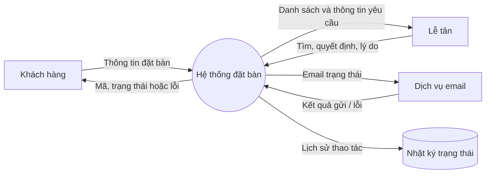

# 13 — Use Case, Data Flow và UAT

## Mục tiêu
Mô tả ai dùng hệ thống để đạt mục tiêu gì, chi tiết hóa luồng chính/ngoại lệ, rồi kiểm tra bằng UAT theo ngôn ngữ nghiệp vụ. Nội dung là case study giả lập; các quy tắc chưa được stakeholder xác nhận cần để trạng thái “open”.

## 1. Actor và mục tiêu

| Actor | Mục tiêu | Quyền / ranh giới cần xác minh |
|---|---|---|
| Khách hàng | Gửi yêu cầu, nhận mã/trạng thái và kết quả | Có tra cứu qua mã + thông tin xác minh không? |
| Lễ tân | Tra cứu, xác nhận hoặc từ chối yêu cầu | Có được xem mọi ca/ngày hay chỉ ca phụ trách? |
| Quản lý ca | Xử lý ngoại lệ hoặc duyệt quyết định nếu chính sách yêu cầu | Khi nào cần chuyển cấp? Quyền nào được ủy quyền? |
| Dịch vụ email | Gửi thông báo trạng thái | Lỗi gửi, retry và log được quan sát ở đâu? |

**System boundary:** hệ thống đặt bàn trực tuyến. Ngoài phạm vi MVP theo giả định hiện tại: thanh toán, ghép bàn tự động, tích hợp CRM và hủy tự phục vụ; cần xác nhận phạm vi với sponsor.

## 2. Danh mục Use Case

Sơ đồ khái quát editable: [39-Reservation-Use-Case.drawio](./39-Reservation-Use-Case.drawio). Đây là draft học tập; actor/permission/policy cần xác nhận. Association chỉ nêu actor tham gia use case, không biểu thị thứ tự hay luồng dữ liệu. Giữ diagram ở mức mục tiêu người dùng; chi tiết sequence/exception xem các mục sau.

| ID | Use Case | Actor chính | Liên kết |
|---|---|---|---|
| UC-01 | Gửi yêu cầu đặt bàn | Khách hàng | BR-02, FR-01–04, US-01, UAT-01–05 |
| UC-02 | Xử lý yêu cầu đặt bàn | Lễ tân | BR-01, FR-05, US-02, UAT-06/07/10/11 |
| UC-03 | Tra cứu yêu cầu | Lễ tân | FR-07, US-04, NFR-02, UAT-09 |
| UC-04 | Thông báo kết quả | Dịch vụ email | FR-06, US-03, UAT-08 |
| UC-05 | Hủy đặt bàn | Khách hàng/nhân viên được ủy quyền | FR-08, US-05; ngoài MVP tới khi chốt chính sách |

Trong diagram draft, **Record Booking Decision (confirm/reject)** được giữ thành một use case vì hai outcome là các nhánh thay thế của cùng mục tiêu nhân viên xử lý một request. Không tách use case chỉ vì có hai nút hoặc hai trạng thái cuối. Tách `Confirm Booking` và `Reject Booking` nếu việc từ chối có actor/quyền, trigger, workflow, quy tắc hoặc giá trị độc lập đủ khác biệt để cần quản lý/test như mục tiêu riêng; nếu tách, vẫn giữ liên kết với UC-02/FR-05 và làm rõ lý do từ chối.

UC-01 *bao gồm* kiểm tra dữ liệu và kiểm tra khả năng nhận. UC-02 ghi lịch sử thay đổi như một hậu điều kiện bắt buộc theo BRULE-05. Email là hành vi sau quyết định, nhưng việc gửi lỗi không được làm mất quyết định đã lưu. Quan hệ `include/extend` cần dùng nhất quán nếu mô hình thành UML; không nối tùy tiện chỉ để làm sơ đồ đẹp.

## 3. Use case chi tiết UC-01 — Gửi yêu cầu đặt bàn

- **Phạm vi:** hệ thống đặt bàn trực tuyến.
- **Actor chính:** khách hàng.
- **Kích hoạt:** khách chọn gửi form đặt bàn.
- **Tiền điều kiện:** hệ thống nhận đặt cho ngày/giờ được chọn; quy tắc giờ hoạt động và sức chứa đã cấu hình.
- **Điều kiện thành công:** một reservation được tạo với mã duy nhất và trạng thái `PENDING`; khách thấy mã/trạng thái.
- **Điều kiện thất bại:** không tạo reservation nếu dữ liệu không hợp lệ, khung giờ đóng hoặc không còn sức chứa.

### Luồng chính
1. Khách nhập ngày giờ, số người, tên và ít nhất một kênh liên hệ theo chính sách.
2. Hệ thống kiểm tra trường bắt buộc, định dạng và quy tắc giờ hoạt động.
3. Hệ thống xác định slot và sức chứa còn lại.
4. Hệ thống nhận yêu cầu, gán mã duy nhất và lưu trạng thái `PENDING`.
5. Hệ thống ghi sự kiện tạo mới vào lịch sử.
6. Hệ thống trả mã và trạng thái cho khách; chuyển yêu cầu vào queue nhân viên.

### Luồng thay thế / ngoại lệ
- **A1 — Dữ liệu không hợp lệ:** báo trường và lý do sửa được; không tạo reservation.
- **A2 — Ngoài giờ/slot đóng:** báo khung giờ không nhận và cho khách chọn lại; không tạo reservation.
- **A3 — Không đủ sức chứa:** trả draft `409 SLOT_UNAVAILABLE`; báo slot không khả dụng, cho khách chọn lại; không tạo reservation hoặc initial history event.
- **A4 — Gửi trùng do retry:** hành vi chưa chốt; hỏi về idempotency để tránh tạo booking trùng.
- **A5 — Hai khách gửi đồng thời cho chỗ cuối:** sức chứa không được vượt; cơ chế xử lý kỹ thuật và thông điệp cho yêu cầu thua cuộc cần đội delivery xác nhận.

## 4. Use case chi tiết UC-02 — Xử lý yêu cầu

- **Actor chính:** lễ tân.
- **Tiền điều kiện:** nhân viên đã đăng nhập, có quyền, và yêu cầu đang `PENDING`.
- **Kích hoạt:** nhân viên mở một yêu cầu trong danh sách.
- **Hậu điều kiện thành công:** trạng thái thành `CONFIRMED` hoặc `REJECTED`; lịch sử ghi trạng thái cũ/mới, actor, thời điểm, lý do nếu có.

### Luồng chính
1. Lễ tân tìm và mở yêu cầu.
2. Hệ thống hiển thị thông tin cần thiết theo quyền.
3. Lễ tân chọn xác nhận hoặc từ chối.
4. Nếu từ chối, lễ tân nhập lý do theo chính sách.
5. Hệ thống xác minh trạng thái hiện tại vẫn là `PENDING`.
6. Hệ thống lưu chuyển trạng thái và lịch sử trong cùng một thao tác nghiệp vụ.
7. Hệ thống yêu cầu gửi thông báo cho khách; lỗi email được ghi nhận để xử lý lại.

### Luồng thay thế / ngoại lệ
- Nhân viên chưa đăng nhập/không có quyền: từ chối truy cập; không trả dữ liệu khách.
- Yêu cầu đã được người khác xử lý: không ghi đè; tải lại trạng thái và báo xung đột.
- Thiếu lý do từ chối nếu lý do bắt buộc: không đổi trạng thái.
- Email lỗi: quyết định vẫn được giữ; hệ thống ghi lỗi và hỗ trợ retry/đối soát theo chính sách.

## 5. Data flow ở mức ngữ cảnh
Đây là sơ đồ luồng trao đổi thông tin, không phải UML Use Case hay BPMN.

Khi tự vẽ bằng diagrams.net, dùng external entity, process/system boundary và data flow có tên dữ liệu. Không dùng arrow để biểu thị control-flow nếu mục tiêu là Data Flow Diagram.

## 6. Ma trận Use Case → UAT → dữ liệu

| Use Case | UAT | Bằng chứng cần thấy | Kết quả mong đợi |
|---|---|---|---|
| UC-01 gửi hợp lệ | UAT-01 | Reservation, code, trạng thái, lịch sử tạo | Một mã mới, `PENDING`, slot không vượt sức chứa |
| UC-01 thiếu liên hệ/số người sai | UAT-02/03 | HTTP/form validation, không có row mới | Báo lỗi đúng trường; không tạo dữ liệu |
| UC-01 slot ngoài giờ/hết chỗ | UAT-04/05 | Quy tắc giờ, capacity, response code | Báo lý do; không tạo reservation |
| UC-02 xác nhận/từ chối | UAT-06/07/10 | trạng thái và history | Actor/thời điểm đúng; transition sai bị chặn |
| UC-02 mở queue không có yêu cầu khớp | UAT-11 | queue response/UI state, scope/filter đã dùng | Không có dòng; empty state đúng thiết kế, không lộ dữ liệu ngoài phạm vi |
| UC-03 tra cứu / phân quyền | UAT-09 và test nhân viên hợp lệ | kết quả lọc, role, payload | Người không quyền không xem được dữ liệu |
| UC-04 email | UAT-08 | trạng thái nghiệp vụ và notification log | Trạng thái không mất khi provider lỗi |

### UAT-08 walkthrough — quyết định lưu, email lỗi

**Mục tiêu:** kiểm tra rằng lỗi gửi thông báo không đảo ngược quyết định đặt bàn đã được lưu. Đây là kịch bản học tập dựa trên mock; chưa phải UAT của nhà hàng thật.

**Tiền điều kiện:**

- Dùng môi trường test và reservation giả đang `PENDING`.
- Actor có quyền xác nhận theo role/policy của test environment.
- Notification provider được stub để trả lỗi xác định; không gửi email thật.
- Policy notification đã định nghĩa cách biểu diễn lỗi. Nếu chưa có, giữ những chi tiết đó ở trạng thái `Open/Blocked`.

**Thao tác:** nhân viên mở reservation, xác nhận một lần, rồi xem trạng thái nghiệp vụ, status history và notification result.

| Kiểm tra | Kết quả mong đợi | Bằng chứng cần ghi |
|---|---|---|
| Booking state | `PENDING → CONFIRMED`; lỗi email không rollback quyết định | Reference giả, trạng thái trước/sau, ảnh hoặc response đã khử dữ liệu |
| Audit history | Một transition xác nhận, actor và timestamp theo quy tắc được duyệt | History row hoặc audit view trong môi trường test |
| Notification | Có dấu lỗi gắn với lần gửi/booking; giá trị status cụ thể phải khớp contract đã duyệt | Notification result/log từ stub, loại lỗi và timestamp |
| Trùng thao tác | Một lần xác nhận chỉ tạo một transition hợp lệ; retry/duplicate notification cần scenario riêng | Số transition và notification attempts |

**Actual result / run status:** để trống cho tới khi người chạy thực hiện. Ghi `Pass/Fail/Blocked`, môi trường/build, người chạy, thời điểm, test data ID và evidence link. Không ghi `Pass` từ expected result hoặc từ file collection. Nếu dùng mock hiện tại, `FAILED_SIMULATED` chỉ chứng minh nhánh giả lập được phản hồi; không chứng minh deliverability, provider behavior hay retry production.

**Open decisions:** nhân viên vai trò nào xem lỗi; error có permanent/transient/unknown không; ai retry, retry tối đa khi nào; trạng thái `sent` khác `delivered` ra sao; log che số điện thoại và lưu bao lâu. Chưa chốt những điều này thì có thể xác nhận invariant booking không rollback trong test hẹp, nhưng chưa thể ký readiness vận hành cho notification.

### UAT-11 walkthrough — queue rỗng

**Mục tiêu:** kiểm tra AC-US02-04 ở mức nghiệp vụ. Đây là case draft cho queue tùy chọn, chưa được stakeholder duyệt và chưa chạy.

**Tiền điều kiện:** mock API local đang chạy; dùng dữ liệu seed tổng hợp; actor dùng header role giả lập; ghi rõ query/filter và phạm vi ngày. Không xóa dữ liệu thật để tạo trạng thái rỗng. Trong fixture hiện tại có reservation ngày `2026-12-05`, vì vậy dùng ngày seed không có dữ liệu như `2026-12-06` để kiểm tra API trả kết quả rỗng; đây chỉ là “không có kết quả theo filter ngày”, không chứng minh queue toàn hệ thống không có yêu cầu.

**Thao tác API trong Postman:** gửi `GET http://127.0.0.1:3000/api/reservations?date=2026-12-06` với `X-Training-Staff: demo`. Ghi status và body thực tế; expected của mock contract là `200`, `total: 0`, `items: []`. Header chỉ là stub, không phải xác thực an toàn. Request này chứng minh response cho filter không khớp; không chứng minh UI có empty state đúng.

**Thao tác UI:** mở đúng prototype/build được review và dùng cùng filter/scope. Nếu chưa có empty-state frame hoặc hành vi chưa được thống nhất, ghi phần UI là `Blocked/Open`, nêu owner cần quyết định copy, CTA và khác biệt giữa queue rỗng với filter không có kết quả. Không suy ra UI pass từ API `200`.

| Kiểm tra | Kết quả mong đợi | Bằng chứng cần ghi |
|---|---|---|
| Danh sách | Không có dòng reservation khớp scope; không trả dữ liệu ngoài quyền/phạm vi | Filter/scope, response hoặc ảnh đã khử dữ liệu |
| Empty state | Hiển thị theo UX đã duyệt; copy và hành động tiếp theo còn TBD cho tới khi được duyệt | Prototype/version hoặc decision link |
| API filter không khớp | Mock trả `200`, `total = 0`, `items = []` cho ngày seed không có record | Postman request/response đã lưu; ghi rõ đây là mock và filter theo ngày |
| Phân biệt trạng thái | Ghi rõ queue thật sự không có yêu cầu hay chỉ không có kết quả do filter; đây có thể là hai scenario khác nhau | Test data setup và filter state |

**Actual result / run status:** để trống cho tới khi thực thi. Ghi Pass/Fail/Blocked, môi trường/build, người chạy, thời điểm và evidence. Không suy ra Pass từ AC hoặc prototype.

## 7. Chuẩn bị và chạy UAT
1. Chốt phạm vi và người có quyền nghiệm thu; xác nhận môi trường và dữ liệu test giả.
2. Đọc từng scenario với người dùng nghiệp vụ, xác định trước expected result và bằng chứng.
3. Ghi kết quả Pass/Fail/Blocked, người chạy, thời điểm, build/version, evidence link và defect ID.
4. Với defect, ghi bước tái hiện, actual/expected, mức ảnh hưởng và Use Case/AC liên quan.
5. Tách defect khỏi change request: defect không đạt yêu cầu đã duyệt; change request đề xuất thay đổi phạm vi/định nghĩa.
6. Tổng hợp rủi ro còn lại; người có thẩm quyền quyết định go/no-go. BA ghi nhận quyết định, không tự ký thay sponsor.

## Bài thực hành
- Chọn UC-01 hoặc UC-02 và vẽ use case diagram trong draw.io/Visual Paradigm: actor nằm ngoài system boundary, use case diễn đạt bằng động từ + mục tiêu.
- Chọn một alternate flow, viết UAT theo Given/When/Then và chỉ rõ evidence.
- Mô phỏng lỗi email; giải thích vì sao trạng thái nghiệp vụ cần tách khỏi trạng thái gửi notification.

## Câu hỏi tự kiểm tra
1. Vì sao “email gửi thất bại” không có nghĩa là reservation bị từ chối?
2. Ai xác nhận tiền điều kiện và quyền actor trong môi trường thật?
3. Với gửi trùng do retry, cần hỏi gì trước khi chọn cách xử lý?
4. Một DFD khác BPMN ở mục tiêu biểu diễn nào?

