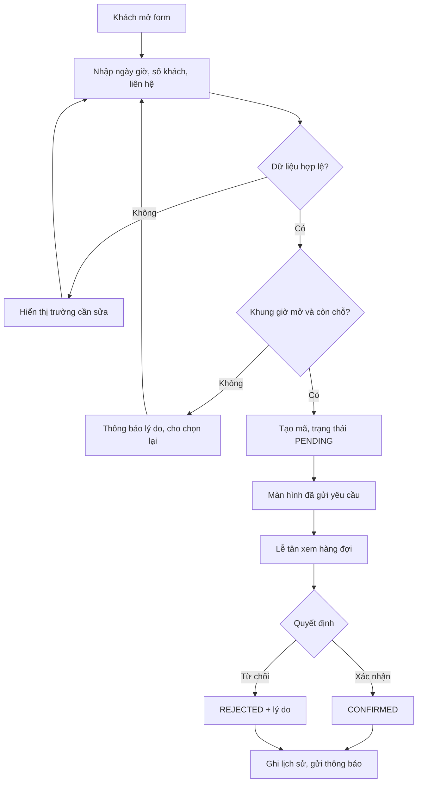
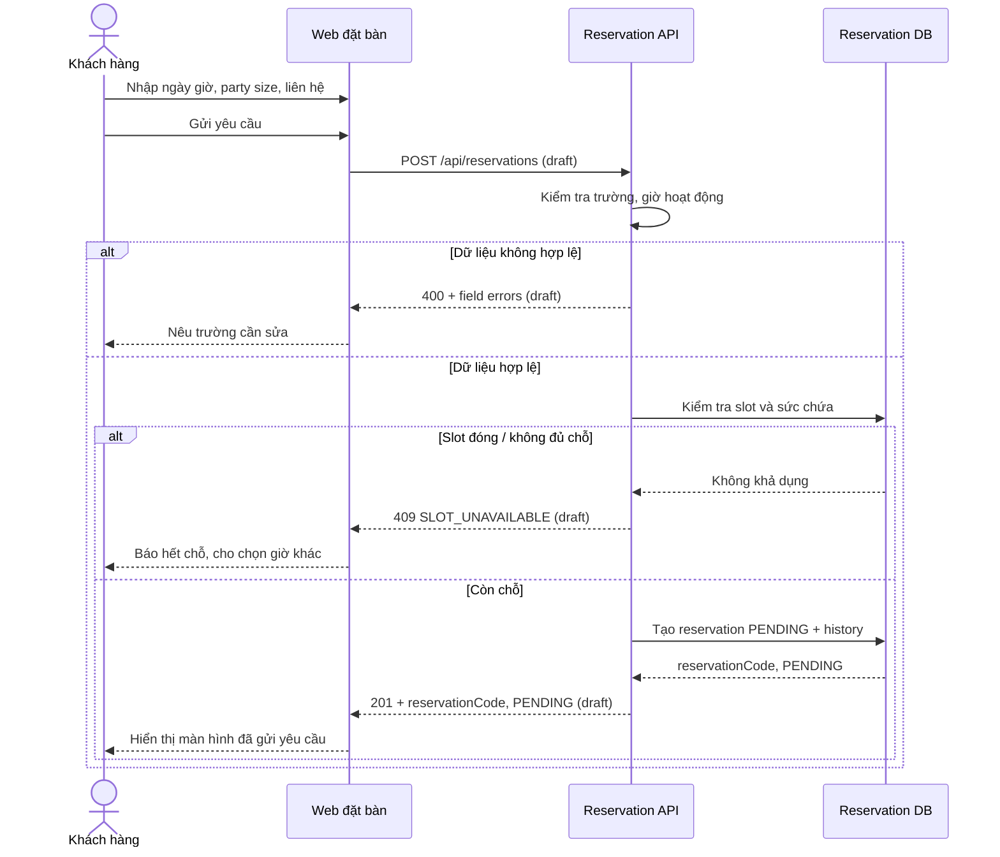
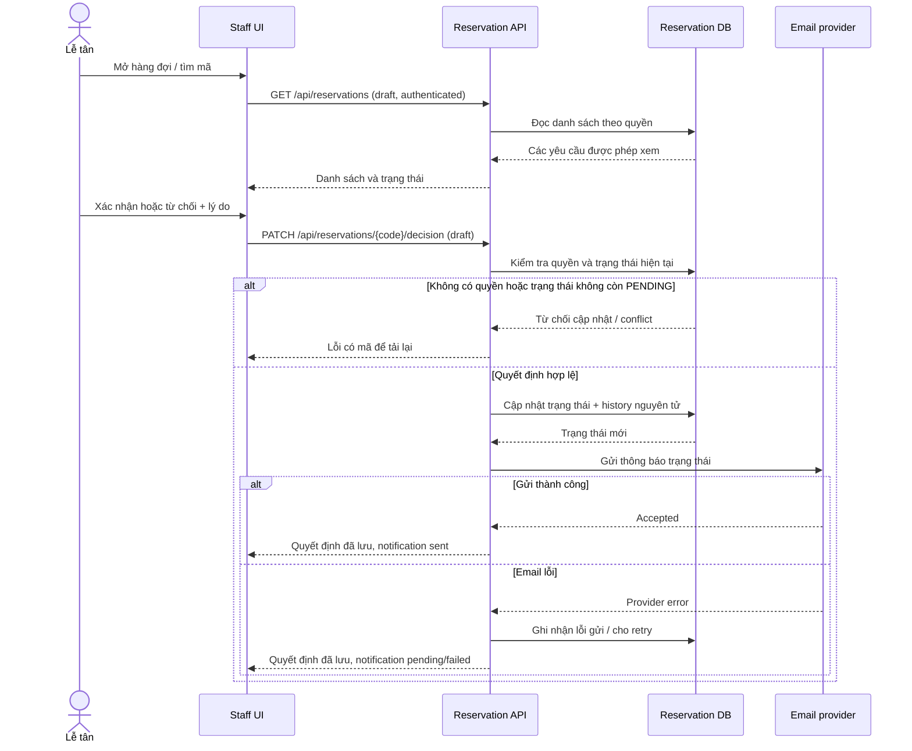

# 14 — Sequence Diagram và Figma User Flow

## Mục tiêu
Nối Use Case với thông điệp giữa actor, giao diện, API, dữ liệu và dịch vụ ngoài; dùng Figma để kiểm tra người dùng hiểu bước kế tiếp. Sequence dưới đây là contract đề xuất cho case study, cần đội delivery thống nhất endpoint, trạng thái và lỗi.

## Figma prototype
File: [BA Practice — Restaurant Reservation](https://www.figma.com/design/xjmPRRKTD2DUC0r7YTxD0c?node-id=6-224)

Ba frame hiện có:
1. **Customer / Submit Request** — form đặt bàn (FR-01–04, UC-01, US-01).
2. **Customer / Request Submitted** — trạng thái `PENDING`, mã yêu cầu và bước kế tiếp; không nói rằng bàn đã được xác nhận.
3. **Staff / Reservation Queue** — danh sách, lọc, trạng thái và thao tác nhân viên (FR-05/07, UC-02/03).

Figma dùng component Button và Input Field từ Simple Design System; các badge, typography và màu ngữ nghĩa là component/token cục bộ của file thực hành. Inter là font placeholder cho case study vì chưa có sản phẩm thật hay mã nguồn xác định font. Tên nhà hàng, số hotline, khách và số liệu đều hư cấu.

## User flow

Màn hình xác nhận chỉ nên xuất hiện sau khi API trả kết quả tạo yêu cầu thành công. Lỗi validation hoặc hết chỗ phải giữ khách ở form, giữ dữ liệu đã nhập nếu phù hợp và giải thích cách sửa/chọn lại.

## Sequence 1 — Khách gửi yêu cầu

Status code, URI và JSON errors trong dấu “draft” là đề xuất cần thống nhất với kỹ thuật; [API contract hiện tại](./05-API-and-UAT.md) mới xác định một phần.

## Sequence 2 — Nhân viên ra quyết định

Không nên đặt cập nhật reservation sau email; nếu provider lỗi thì kết quả nghiệp vụ vẫn phải được lưu như BRULE-05/US-03. Transaction giữa trạng thái và lịch sử là đề xuất để tránh một phần được lưu, phần kia thất bại.

## Truy vết

| UI / bước | Requirement | API/data | Kiểm tra |
|---|---|---|---|
| Form ngày/giờ/số khách/liên hệ | FR-01/02/03 | POST reservation, availability slot | UAT-01–05 |
| Màn hình đã gửi | FR-04 | code + `PENDING` | UAT-01 |
| Queue và quyết định | FR-05/07, NFR-02/03 | GET/PATCH, reservation history | UAT-06/07/09/10 |
| Thông báo kết quả | FR-06 | email event/log | UAT-08 |

## Bài thực hành công cụ
1. Trong Figma, mở prototype, chọn từng frame, kiểm tra tên frame và UI copy có khớp Use Case không.
2. Tự thêm annotation cạnh field “Ngày đến”: input invalid, slot unavailable, và state sau submit; annotation phải ghi requirement ID.
3. Nếu tạo prototype connections trong Figma, nối nút submit tới confirmation state dưới giả định success; tạo riêng error state cho 400/409. Ghi rõ đây là prototype, chưa tích hợp API.
4. Tự vẽ Sequence 1 trong draw.io hoặc Visual Paradigm; mỗi message dùng động từ/endpoint rõ, fragment `alt` có guard, lifeline theo đúng trách nhiệm.
5. So từng response trong Postman với sequence và UAT: không có HTTP response khi backend chưa chạy; prototype không chứng minh API hoạt động.

### Lab Figma — prototype theo trạng thái, không chỉ theo màn hình

Chọn flow submit của khách và tự tạo một bản làm việc/branch theo khả năng tài khoản. Prototype tối thiểu cần các trạng thái sau; tên frame và UI copy phải phản ánh state nghiệp vụ:

| State | Nội dung cần thể hiện | Trace gợi ý | Câu hỏi review |
|---|---|---|---|
| Form ready | Field, required/optional, hành động submit | FR-01, AC-US01-01/02/03 | Khách biết cần cung cấp thông tin liên hệ nào? |
| Validation error | Field lỗi, message cụ thể, dữ liệu đã nhập còn giữ nếu phù hợp | AC-US01-02/03 | Khách biết sửa trường nào và lỗi có thể tiếp cận được không? |
| Slot unavailable | Giải thích slot không khả dụng, cách chọn lại; không hiện success | AC-US01-04, UAT-05 | Message có vô tình ngụ ý request đã được tạo không? |
| Submit in progress | Tránh double-submit; chỉ là prototype behavior | API interaction draft | Có thể gửi lại nhiều lần không; timeout sau submit xử lý thế nào? |
| Submitted / PENDING | Mã request, trạng thái chờ, bước tiếp theo; phân biệt rõ với confirmed | FR-04, AC-US01-01, UAT-01 | Người dùng có hiểu “đã nhận request” chưa phải “đã có bàn” không? |

Tạo prototype connection cho happy path từ Form ready sang Submitted/PENDING. Tạo error path riêng cho validation và slot unavailable. Không nối error path vào success frame. Với timeout, nội dung cần tránh tuyên bố “chưa nhận request” nếu chưa biết server đã ghi dữ liệu chưa; đánh dấu idempotency/reconciliation là dependency thay vì tự thiết kế lời hứa UI.

**Cách tự review Figma:**

1. Thêm annotation ngoài UI, không nhồi implementation notes vào nội dung người dùng nhìn thấy. Ghi frame, AC/requirement ID, assumption/open question.
2. Dùng prototype preview như người dùng mới: hoàn thành happy path, rồi thử invalid input và slot không khả dụng.
3. Kiểm tra thứ bậc thị giác, nhãn field, trạng thái focus/error, keyboard access và độ tương phản; nếu không kiểm tra được bằng prototype tĩnh, ghi limitation.
4. Ghi feedback theo `người review (vai trò) | task | quan sát | mức độ | đề xuất | quyết định`. Không bịa feedback stakeholder; có thể tự review và gắn nhãn self-review.
5. Xuất ảnh hoặc link quyền xem; lưu version và ghi rõ prototype chưa tích hợp API. Không coi click-through là bằng chứng backend chạy đúng.

**Checkpoint:** reviewer có thể phân biệt rõ form lỗi, slot hết chỗ và request thành công; trạng thái thành công ghi `PENDING`, không hứa đã xác nhận; mọi state có trace tới requirement/AC; prototype có ít nhất một happy path và hai error paths. File mẫu do trợ lý chuẩn bị không tính là evidence mastery của người học.

## Câu hỏi review
- UI hiện tại có nói rõ khách đang gửi yêu cầu, chưa phải đặt bàn đã xác nhận không?
- Nếu API timeout sau khi DB đã tạo reservation, khách retry có thể tạo bản ghi trùng không? Cần hỏi về idempotency.
- Thông báo email lỗi hiển thị thế nào với lễ tân, ai retry, retry bao lâu?
- Phân quyền và giới hạn hiển thị dữ liệu khách đang nằm ở bước nào?

## Hạn chế bản dựng
Sequence/API là hợp đồng đề xuất; mock backend để luyện Postman có ở [practice-api/server.js](./practice-api/server.js), không phải backend production. Màn Figma là prototype tĩnh để thảo luận, chưa có tương tác/API thật; số liệu dashboard chỉ để minh họa, không thể xem là KPI thật. Bản screenshot đầu tiên đã giúp phát hiện lỗi giãn ô; component fields và status badges đã được chỉnh trong Figma. Lượt chụp kiểm tra sau chỉnh sửa bị giới hạn lượt gọi của Figma Starter nên chưa có ảnh hậu chỉnh sửa để xác minh trực quan cuối cùng.

